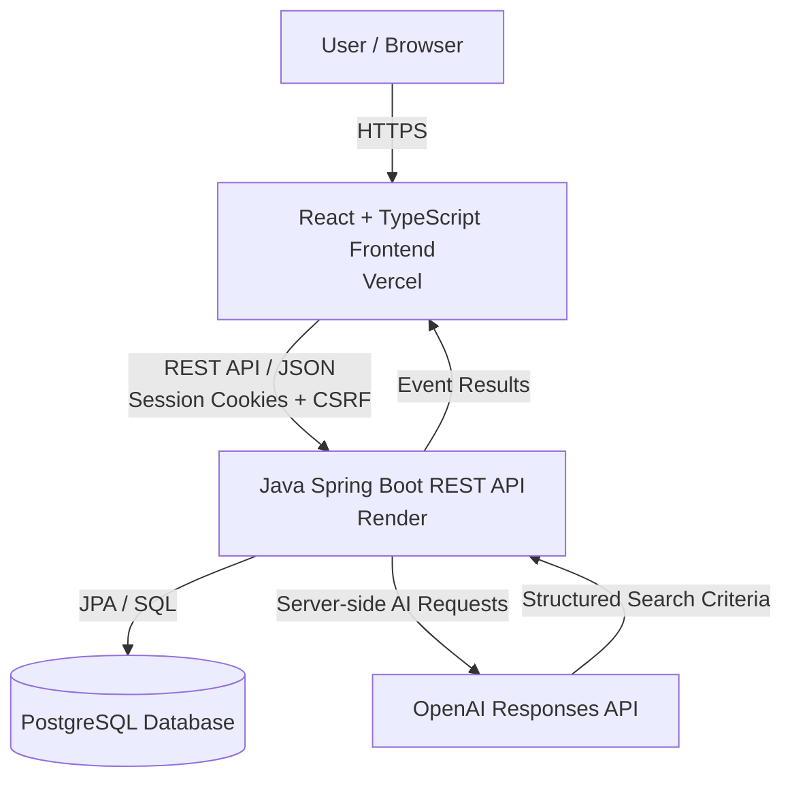
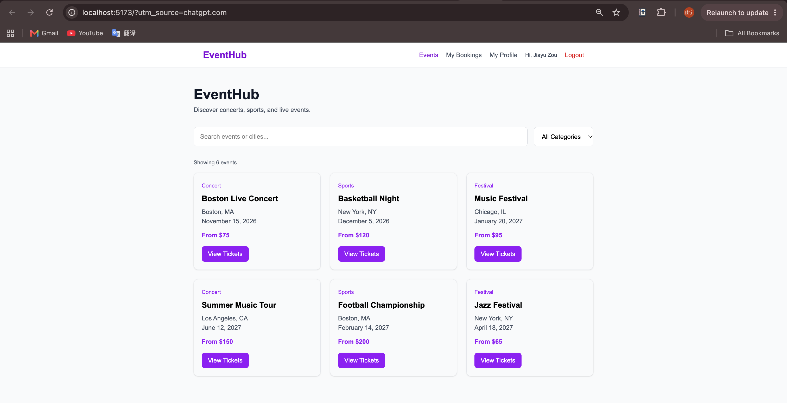
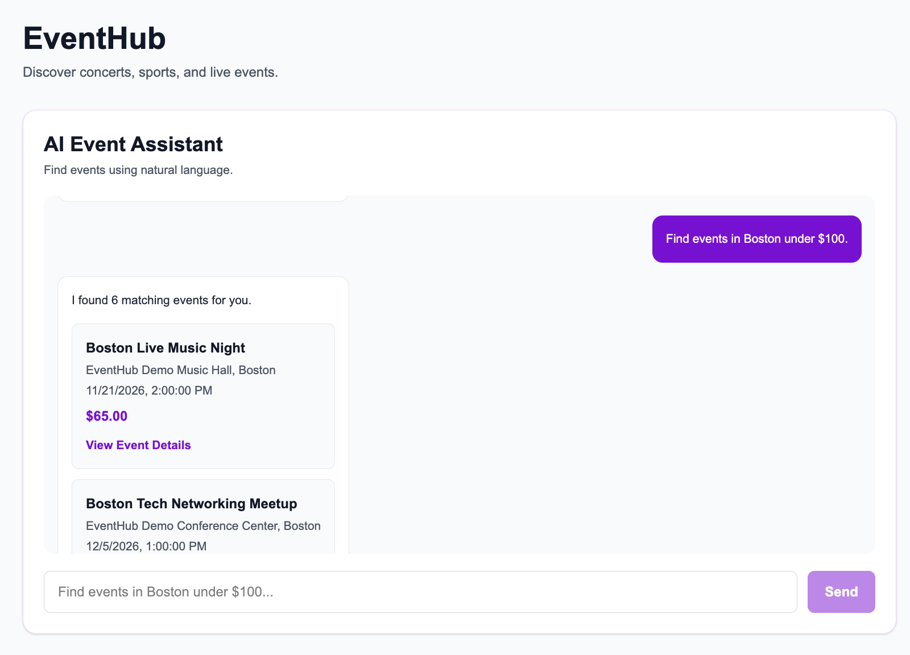
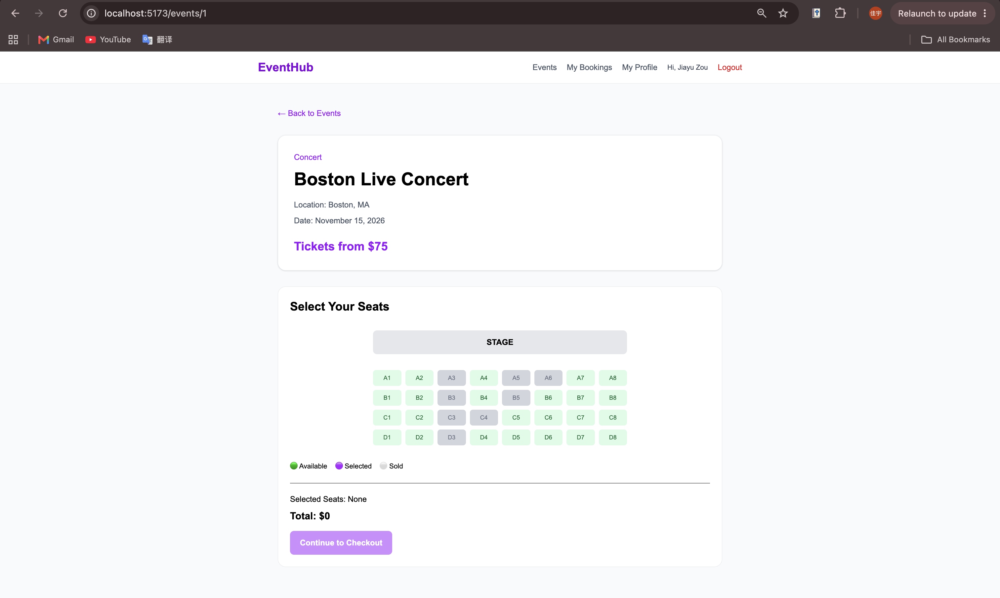
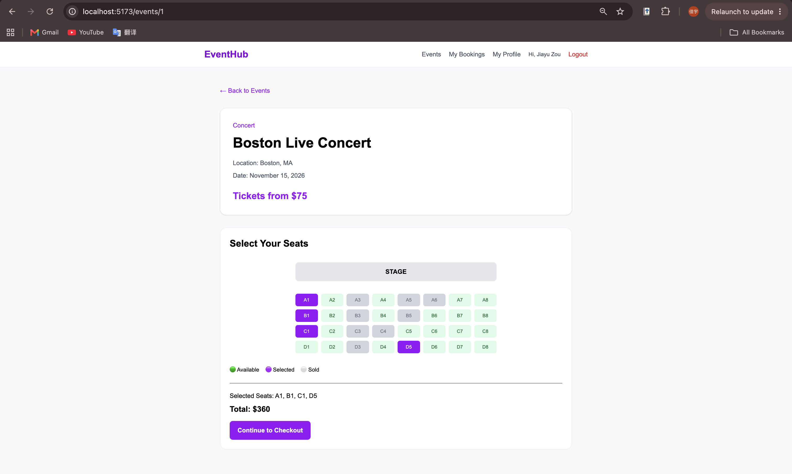
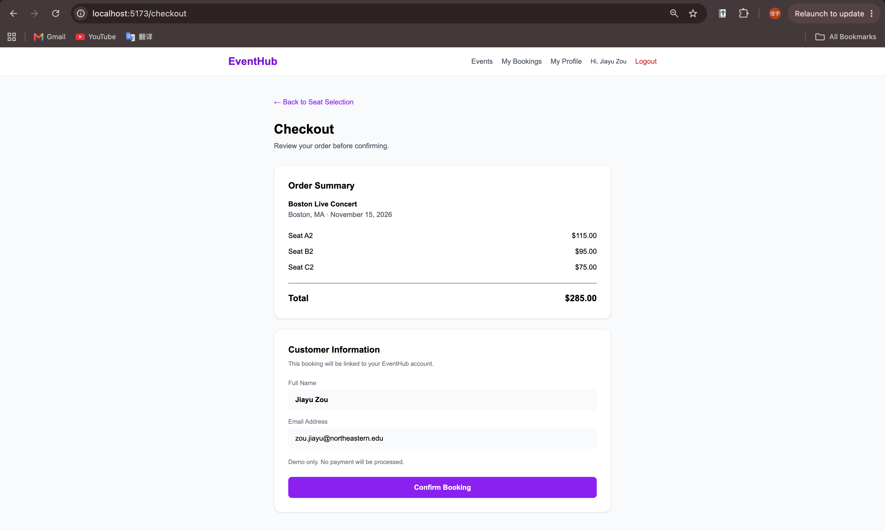
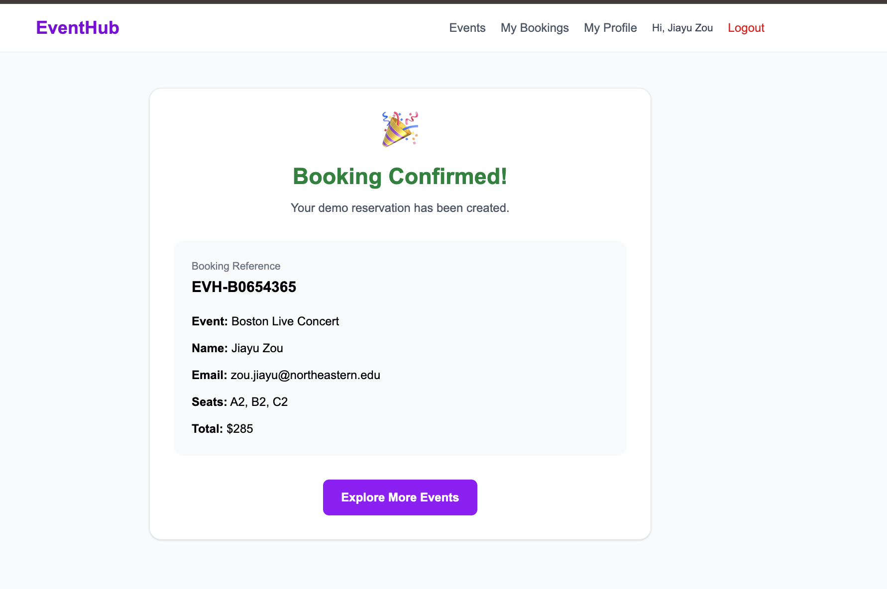
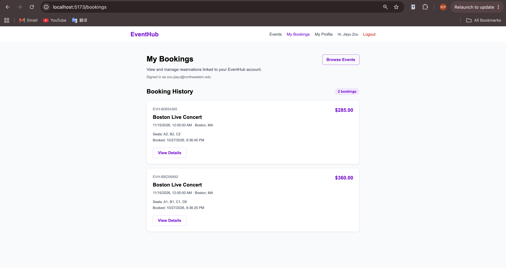
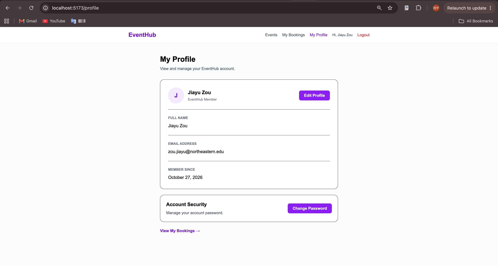

# EventHub

### Full-Stack Event Discovery & Ticket Booking Platform with AI-Powered Search

[Live Demo](https://eventhub-chi-ten.vercel.app) | [GitHub Repository](https://github.com/jiayu1123/eventhub)

EventHub is a full-stack web application for discovering events, exploring ticket availability, selecting seats, and managing reservations.

The platform integrates an AI-powered event assistant that translates natural-language requests into structured search criteria, allowing users to discover events by location, date, and price.

Built with React, TypeScript, Java, Spring Boot, and PostgreSQL, EventHub demonstrates full-stack application development, RESTful API integration, relational database design, authentication, concurrency-aware seat reservations, and cloud deployment.

> **Demo notice:** EventHub currently uses fictional demonstration events and venues. It does not sell tickets to real-world events.

## Features

### AI-Powered Event Discovery
- Search for events using natural-language requests.
- Extract search criteria through the OpenAI API.
- Query PostgreSQL for matching events.
- Display matching results in the web interface.
- Keep OpenAI API credentials on the backend.

**Example queries:**
- Find events in Boston under $100.
- Show me events in Seattle.
- Find events in New York under $80.

### Event Browsing and Filtering
- Browse events across multiple cities.
- Search by event name or location.
- Filter events by category.
- View event details, venue information, dates, and ticket prices.
- Use a responsive interface across screen sizes.

### Interactive Ticket Booking
- View available seats for each event.
- Select seats through an interactive interface.
- Review ticket prices before confirming a booking.
- Prevent conflicting active reservations using database constraints.
- Preserve historical booking records when reservations are cancelled.

### Authentication and Account Management
- Register and sign in.
- Authenticate using server-managed sessions.
- Protect authenticated operations with session and CSRF controls.
- View personal booking history.
- Cancel reservations and release seats.
- Manage account information.

## Technology Stack

| Layer | Technologies |
|---|---|
| Frontend | React 19, TypeScript, Vite, Tailwind CSS |
| Routing | React Router |
| Backend | Java 21, Spring Boot 4, REST APIs |
| Database | PostgreSQL |
| Database Migrations | Flyway |
| Persistence | Spring Data JPA, Hibernate |
| AI Integration | OpenAI Responses API |
| Authentication | Session-based authentication, CSRF protection |
| Frontend Testing | Vitest, React Testing Library |
| Backend Testing | JUnit, Spring Boot Test |
| Deployment | Vercel, Render, Docker |
| Development Tools | Git, GitHub, Maven, npm |

## System Architecture



### Request Flow

**Standard event search**
1. The user searches or filters events in the React frontend.
2. The frontend sends a request to the Spring Boot REST API.
3. The backend queries PostgreSQL.
4. Matching events are returned to the frontend.

**AI-assisted event search**
1. The user submits a natural-language request.
2. The frontend sends the request to the Spring Boot backend.
3. The backend calls the OpenAI API to interpret the search criteria.
4. The backend searches PostgreSQL using those criteria.
5. Matching events are returned to the user.

**Ticket reservation**
1. The authenticated user selects an event and available seats.
2. The backend validates the reservation request.
3. Database constraints prevent conflicting active seat reservations.
4. Booking records are persisted in PostgreSQL.
5. The user can view or cancel the reservation.

## Database Design

EventHub uses PostgreSQL to store relational application data.

Core tables include:

| Table | Purpose |
|---|---|
| `users` | User accounts |
| `events` | Event details and pricing |
| `event_seats` | Seat inventory and seat-level pricing |
| `bookings` | Reservation records and status |
| `booking_seats` | Historical booked seats and price snapshots |
| `active_seat_reservations` | Currently reserved seats |

Flyway manages versioned schema migrations, including booking-history preservation and demo-data initialization.

## Project Structure

```text
eventhub/
├── backend/
│   ├── src/
│   │   ├── main/
│   │   │   ├── java/com/eventhub/
│   │   │   └── resources/
│   │   │       └── db/migration/
│   │   └── test/
│   ├── Dockerfile
│   ├── mvnw
│   └── pom.xml
├── src/
│   ├── api/
│   ├── components/
│   ├── context/
│   ├── pages/
│   ├── types/
│   ├── App.tsx
│   └── main.tsx
├── public/
├── screenshots/
├── package.json
├── vite.config.ts
├── vercel.json
└── README.md
```

The `backend/` directory contains the current Java backend used for deployment.

## Getting Started

### Prerequisites

- Node.js and npm
- Java 21
- PostgreSQL
- Git

### 1. Clone the repository

```bash
git clone https://github.com/jiayu1123/eventhub.git
cd eventhub
```

### 2. Configure PostgreSQL

Create a PostgreSQL database named `eventhub`.

Configure the following backend environment variables:

| Variable | Description |
|---|---|
| `DB_URL` | PostgreSQL JDBC connection URL |
| `DB_USERNAME` | PostgreSQL username |
| `DB_PASSWORD` | PostgreSQL password |
| `OPENAI_API_KEY` | OpenAI API key for AI-assisted search |
| `PORT` | Optional backend HTTP port (default: 8080) |

The backend configuration provides local development defaults for PostgreSQL.

Flyway runs database migrations during application startup.

### 3. Start the backend

From the project root:

```bash
cd backend
./mvnw spring-boot:run
```

The backend runs at:

`http://localhost:8080`

### 4. Start the frontend

Open another terminal:

```bash
cd eventhub
npm install
npm run dev
```

Open:

`http://localhost:5173`

The frontend development server must be configured to forward API requests to the local backend.

## Testing

### Backend

From the `backend/` directory:

```bash
./mvnw test
```

The backend test suite includes coverage for AI search service behavior, API integration, and security.

### Frontend

From the project root:

```bash
npx vitest run
npm run build
npm run lint
```

The frontend includes automated tests for the AI event assistant.

## Deployment

EventHub is deployed using separate frontend and backend services.

| Component | Platform |
|---|---|
| React frontend | Vercel |
| Spring Boot backend | Render |
| Backend packaging | Docker |
| Database | PostgreSQL |

**Frontend:** https://eventhub-chi-ten.vercel.app

**Backend API:** https://eventhub-backend-ftwg.onrender.com/api/events

The frontend communicates with the backend through API routing. Sensitive credentials, including the OpenAI API key and database password, remain on the server.

The backend uses Flyway migrations to initialize and update the database schema.

## Engineering Highlights

**Full-stack integration:** Connected a React and TypeScript frontend to a Java Spring Boot backend through REST APIs.

**AI-assisted search:** Integrated the OpenAI API to interpret natural-language requests and translate them into database-backed event searches.

**Reservation integrity:** Designed relational seat inventory and active-reservation constraints to prevent conflicting bookings while preserving cancellation history.

**Authentication and security:** Implemented session-based authentication and CSRF protection for authenticated API operations.

**Database migrations:** Used Flyway to manage schema evolution and maintain consistent database structures across environments.

**Cloud deployment:** Deployed the frontend on Vercel and a Dockerized Spring Boot backend on Render.

**Automated testing:** Added frontend component tests and backend service, integration, and security tests.

## Screenshots

### Homepage

Browse events and search by city, category, or keyword.



### AI-Powered Event Search

Discover events using natural-language queries powered by OpenAI and PostgreSQL.



### Event Details

View event information, ticket pricing, and booking options.



### Interactive Seat Selection

Select seats from the available inventory.



### Ticket Checkout

Review selected tickets before booking.



### Booking Confirmation

Review reservation details after completing a booking.



### My Bookings

View booking history and manage reservations.



### User Profile

Manage account information.



## Author

Developed by **Jiayu Zou**

GitHub: https://github.com/jiayu1123
